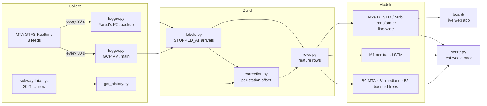

# Countdown Clock Challenge (Group 8)

**Yared Tsegaye Gizaw · Alefew Yimam** · Deep Learning final project, Fall 2026

Can a neural network predict when an NYC subway train will arrive more accurately than the MTA's own platform countdown clocks?

We record the MTA's live predictions for three weeks, train models on 5 years of past train movements, and score both against the true arrival times on a test week that nobody looks at until the models are frozen.

**Pilot (Oct 18, one evening):** a small LSTM beat the MTA at every horizon.

| Minutes ahead | 0–2 | 2–5 | 5–10 | 10–20 | 20–30 |
|---|---|---|---|---|---|
| MTA error (MAE, s) | 35 | 47 | 67 | 103 | 148 |
| LSTM error (MAE, s) | 25 | 33 | 44 | 64 | 88 |

The proposal (accepted) is in [`Group8-CountdownClock.docx`](Group8-CountdownClock.docx), with a LaTeX version in [`overleaf/`](overleaf/).

---

## 1. Data: two sources, and why we need both

| | **History** ([subwaydata.nyc](https://subwaydata.nyc/)) | **Live** (our recorder, [`countdown/logger.py`](countdown/logger.py)) |
|---|---|---|
| What it is | When every train was at every stop, Apr 2021 → now | The MTA's realtime feeds, polled every 30 s, Oct 31 → Nov 21 |
| Size | ~160 K stop arrivals/day, ~1 MB/day | ~230 MB/day (26 M MTA prediction rows) |
| MTA predictions | ❌ not archived | ✅ the countdown we have to beat |
| Arrival times | "last reported" time: **30 s late on numbered lines, 75 s late on lettered lines** | **STOPPED_AT** position reports: the moment the train is at the platform (our ground truth) |
| Used for | **Pretraining** (millions of examples of how trains move and how delays spread) | **Fine-tuning, validation, test**, and the MTA comparison |

Neither source is enough alone. History has no MTA predictions and its arrival times run late. Three weeks of live data is too small to train a deep model. So we **pretrain on history, then fine-tune and score on live data**. A per-station offset (`correction.py`) shifts history labels onto the live definition.

**Calendar** (recording started Oct 31, six days later than the proposal):

| Window | Role |
|---|---|
| Apr 2021 – Oct 30 | History: pretraining |
| Oct 31 – Nov 7 | Training week (also fits the history correction) |
| Nov 8 – 14 | Validation week (model selection, early stopping; includes Veterans Day) |
| **Nov 15 – 21** | **Test week: frozen. Nobody opens it before Nov 22.** |

---

## 2. The prediction task

At a moment *p*, take a train whose last confirmed stop is the **anchor**, and predict when it reaches each later **target** stop up to 30 min ahead, using **only information known at *p***.

```
prediction = anchor time + base + ŷ
```

- `base` is the typical travel time from history medians (by line, direction, segment, time of day, weekend).
- The model learns `y` = actual travel time − `base`, with absolute-error (L1) loss.

**Feature vector (one row = one train × one target stop × one moment):**

| Group | Features |
|---|---|
| Trip | `base`, `n_stops` to target, `route`, `direction`, `hour`, `weekend` |
| Train's own state | `elapsed` since the anchor, `overdue` (elapsed − typical segment time), `dev1`, `dev3` (delay over the last 1 / 3 segments) |
| Sequence (LSTM input) | `sd8 … sd1`: delay on each of the last 8 segments, oldest → newest |
| Train ahead | `gap` (headway), `ahead_dev` (its delay over the same stretch, once it got there), `ahead_pace`, `ahead_frac`, `ahead_since` (while it is still on the way) |
| Label | `y`, and `t_b` (true arrival) |
| Live rows only | `mta_pred`: the MTA's prediction at *p*. **Used for scoring only, never as an input.** |

`rows.py` asserts that every feature was known at or before *p* (leakage check).

---

## 3. Architecture



**Models**

| | Model | Input | Owner |
|---|---|---|---|
| B0 | The MTA's own countdown | from the live feed | — |
| B1 | History medians (`base` alone) | — | Yared |
| B2 | Gradient-boosted trees (HistGradientBoosting, L1 loss) | feature vector | Yared |
| **M1** | **Per-train LSTM**: LSTM over `sd8…sd1` + MLP over the other features | one train | **Alefew** |
| **M2a** | **Line-wide BiLSTM**: every train on the line at *p*, ordered along the route; predicts all of a train's later stops in one pass | whole line | **Alefew** |
| M2b | **Line-wide transformer** (~3 layers, 4 heads, d=64, ~100 K params): same input and output as M2a, only the network differs | whole line | Yared |

The deep models must use the course techniques: **Adam, dropout, batch norm, Xavier initialization**. Pretrain on history rows, fine-tune on training-week rows, and early-stop on the validation week.

**Scoring** (`score.py`):
- **Metrics:** MAE per horizon band (0–2, 2–5, 5–10, 10–20, 20–30 min), share of predictions within 60 s, and signed bias.
- **Uncertainty:** 95% bootstrap CIs, resampling whole trains.
- **Splits:** numbered vs lettered lines, time of day, Veterans Day excluded.
- **Sensitivity check:** a re-score using the "last reported" arrival definition.

---

## 4. Repository layout

```
README.md                      this file
Group8-CountdownClock.docx     accepted proposal
overleaf/                      proposal in LaTeX (the final report builds on this)
countdown/
  logger.py                    ✅ recorder: 8 feeds every 30 s → data/raw/YYYY-MM-DD/{predictions,vehicles}.csv.gz
  deploy/                      ✅ systemd unit + VM setup guide (SETUP_VM.md)
  requirements.txt
  get_history.py               ⏳ download subwaydata.nyc → data/history/
  labels.py                    ⏳ arrival = first STOPPED_AT report per (trip, stop); merges VM + PC copies
  correction.py                ⏳ per-station offset, history → STOPPED_AT definition
  rows.py                      ⏳ feature rows → data/rows/*.parquet
  baselines.py                 ⏳ B1, B2
  score.py                     ⏳ the scorer
  notebooks/                   ⏳ Colab: m1_lstm.ipynb, m2a_bilstm.ipynb, m2b_transformer.ipynb
  board/                       ⏳ live board (FastAPI + phone web app)
```

Data is **not** in git. It lives on the shared Google Drive folder `Countdown-Group8/`:
- `raw/`: weekly `.tgz` of the recordings;
- `rows/`: the feature rows. **This is what Colab trains on.**
- `models/`: trained checkpoints.

---

## 5. Tasks

### Alefew

| When | Task | Done when |
|---|---|---|
| **Now – Nov 5** | Read this README and §3–4 of the proposal. Get access to the repo and the Drive folder. Set up a Colab notebook (`notebooks/m1_lstm.ipynb`) that loads `rows/*.parquet` and builds a PyTorch Dataset (the column names are in §2). | Notebook loads the sample rows (uploaded by Nov 5) |
| Nov 3 – 7 | Review `score.py` (the proposal lists you as its reviewer). | Comments sent / issues opened |
| **Nov 6 – 12** | **M1 per-train LSTM.** Pretrain on history rows, fine-tune on training-week rows, early-stop on the validation week. Use Adam, dropout, batch norm and Xavier init. Report validation MAE by horizon band, next to B2. | Checkpoint in `models/`, validation table |
| **Nov 12 – 16** | **M2a line-wide BiLSTM.** First agree with Yared on the line-wide input format, since M2b uses the same one. | Checkpoint + validation table |
| Nov 21 | Freeze M1 and M2a. **No changes after this.** | Final checkpoints on Drive |
| **Nov 21 – 25** | **Live board** (`board/`). FastAPI backend on the VM reads the feed every 30 s, builds rows, and runs the best model exported to ONNX. Phone web app with a station picker, one row per train (MTA vs ours), and a replay mode as a demo backup. | Opens on a phone at one station |
| Nov 22 – 24 | Final scoring with Yared. | Test-week table |
| Nov 26 – 30 | Report and presentation (both). | Submitted |

### Yared

| When | Task | Done when |
|---|---|---|
| ✅ Oct 31 | Recorder on a GCP VM (main) and the PC (backup). Both verified to record the same arrivals. | — |
| **Nov 2 – 5** | `get_history.py`, `labels.py`, `correction.py`, `rows.py`. **Upload sample rows to Drive by Nov 5** so Alefew can start. | Rows on Drive, leakage check passes |
| **Nov 3 – 7** | B1 and B2 baselines, `score.py`. **Freeze the scorer on Nov 7.** | Scorer in git |
| Nov 8 | Upload week 1 to Drive. Rebuild rows on the full training week. **Milestone: baseline table** (B0/B1/B2). | Table in this README |
| Nov 8 – 16 | Review M1 and M2a. Upload week 2 on Nov 15. | — |
| **Nov 15 – 21** | Keep the PC recording (test-week backup). | No gaps |
| **Nov 16 – 20** | **M2b line-wide transformer.** Same input as M2a. Freeze on Nov 21. | Checkpoint + validation table |
| Nov 22 – 24 | Upload week 3. Run `score.py` once on the test week for every model, plus the splits and the sensitivity check. | Test-week table |
| Nov 26 – 30 | Report and presentation (both). Delete the VM in December. | Submitted |

### Rules for both
1. **The test week (Nov 15–21) is not opened before Nov 22.** Models are tuned on the validation week only.
2. **No information from after the prediction moment.** All features must be known at *p*; `rows.py` checks this.
3. **The MTA's prediction is never a model input.** It is only a competitor.
4. **One scorer for every model.** All models are scored by the same frozen `score.py`, not by notebook code.

---

## 6. Running things

```bash
cd countdown
python3 -m venv .venv && .venv/bin/pip install -r requirements.txt
.venv/bin/python logger.py --polls 2          # quick test: two polls into data/raw/
```

- **Recorder on the VM:** see [`countdown/deploy/SETUP_VM.md`](countdown/deploy/SETUP_VM.md).
- **Check it:** `systemctl status countdown-logger` and `tail ~/countdown/data/raw/logger.log` (a `poll …: 8/8 feeds` line every 30 s).
- **Colab:** mount Drive, then read `Countdown-Group8/rows/*.parquet`.
